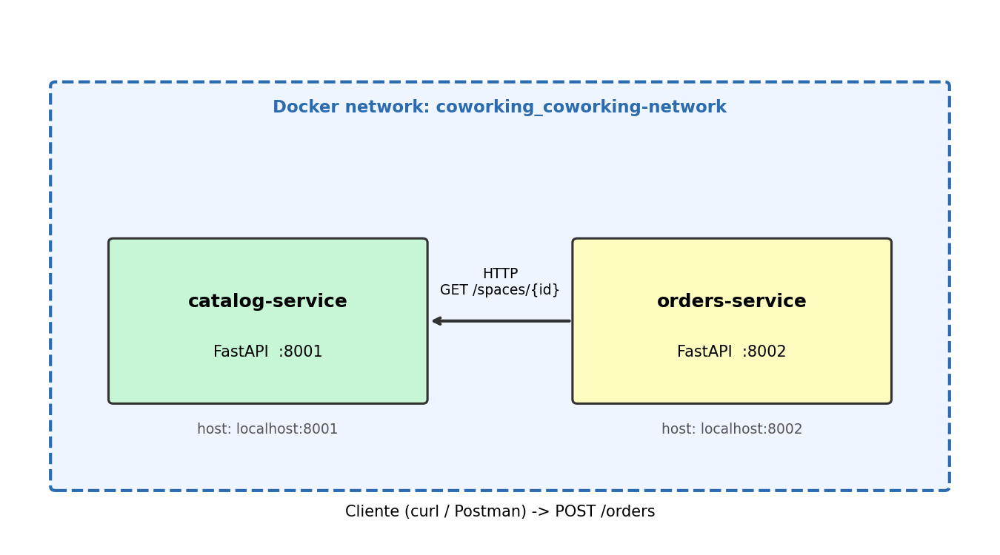

# Coworking Workshop – Microservicios con FastAPI, Docker Compose y Chaos Engineering

Dos microservicios que se comunican por HTTP dentro de una red Docker compartida:

| Servicio | Puerto | Descripción |
|---|---|---|
| `catalog-service` | 8001 | Expone los espacios de coworking |
| `orders-service`  | 8002 | Crea órdenes consultando al catálogo |



## Estructura

```
coworking-workshop/
├── README.md
├── docker-compose.yml
├── chaos-test.sh
├── chaos-test.ps1
├── chaos-report.md
├── architecture-diagram.png
├── coworking.postman_collection.json
├── catalog-service/   (main.py, requirements.txt, Dockerfile)
└── orders-service/    (main.py, requirements.txt, Dockerfile)
```

## LAB 1 y 2 – Prueba local (sin Docker)

```bash
# Terminal 1
cd catalog-service && pip install -r requirements.txt && python main.py

# Terminal 2
cd orders-service && pip install -r requirements.txt
CATALOG_URL=http://localhost:8001 python main.py

# Terminal 3
curl http://localhost:8001/health
curl http://localhost:8001/spaces
curl http://localhost:8001/spaces/1
curl -X POST "http://localhost:8002/orders?space_id=1&user_email=test@example.com&hours=2"
curl http://localhost:8002/orders
```

## LAB 3 – Docker Compose

```bash
docker-compose up --build
curl http://localhost:8001/spaces
curl -X POST "http://localhost:8002/orders?space_id=1&user_email=test@example.com&hours=2"
curl http://localhost:8002/orders
```

## LAB 4 – Chaos: apagar el catálogo

```bash
# Linux / macOS / Git Bash / WSL
chmod +x chaos-test.sh && ./chaos-test.sh
```

```powershell
# Windows PowerShell
.\chaos-test.ps1
# Si Windows lo bloquea:
powershell -ExecutionPolicy Bypass -File .\chaos-test.ps1
```

Esperado: 200 → 503 (`Catalog service unavailable`) → 200.

## LAB 5 – Chaos: cambiar el contrato sin avisar

```bash
# Romper el contrato (price_per_hour -> hourly_rate) en el catálogo
sed -i 's/price_per_hour/hourly_rate/g' catalog-service/main.py
docker-compose up --build -d catalog-service
sleep 10
curl -X POST "http://localhost:8002/orders?space_id=1&user_email=contract@test.com&hours=2"
# -> 500 Internal Server Error (KeyError: 'price_per_hour' en los logs de orders)
docker-compose logs orders-service | tail -20

# Restaurar
sed -i 's/hourly_rate/price_per_hour/g' catalog-service/main.py
docker-compose up --build -d catalog-service
```

Luego completa `chaos-report.md` con los resultados medidos.

## Debugging útil

```bash
docker-compose logs -f
docker-compose ps
docker-compose exec orders-service bash
docker network ls
docker network inspect coworking_coworking-network
docker-compose exec orders-service ping catalog-service
docker-compose build --no-cache
```
